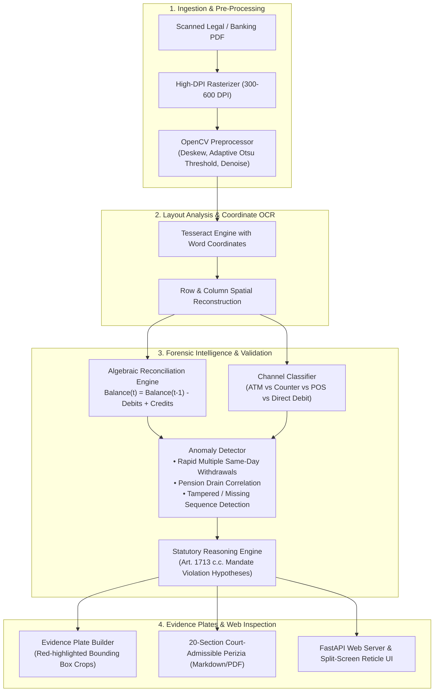

# ⚖️ AvvocatoAI Engine — Forensic Document Intelligence & Legal Reasoning Pipeline

[](https://www.python.org/)
[](https://fastapi.tiangolo.com/)
[](#computer-vision--ocr-architecture)
[](https://opensource.org/licenses/MIT)

> **Autonomous multi-stage forensic document analysis engine. Extracts, reconstructs, reconciles, and detects fraudulent patterns in banking statements and legal records, generating court-admissible visual evidence and statutory hypotheses.**

---

## 🇮🇹 Executive Summary (Italiano)

**AvvocatoAI Engine** è una piattaforma di intelligenza documentale e perizia forense automatizzata, concepita per supportare studi legali, consulenti tecnici d'ufficio (CTU) e periti di parte (CTP) nell'analisi di voluminosi fascicoli bancari e contrattuali.

### Il Problema di Business & Legale:
Nelle controversie civili su conti correnti, violazioni del mandato fiduciario (art. 1713 c.c.) e perizie su gestioni patrimoniali, l'esame manuale di centinaia di pagine scansionate (spesso degradate, a bassa risoluzione o con fotocopie storte) richiede settimane di lavoro peritale. Gli errori di trascrizione manuale possono invalidare una perizia in tribunale.

### La Soluzione Ingegneristica:
AvvocatoAI implementa una pipeline modulare a 7 stadi:
1. **Computer Vision & Ingestion:** Raddrizzamento automatico (deskew), binarizzazione adattiva e segmentazione del layout.
2. **Dual OCR & Bounding Box Mapping:** Estrazione del testo con coordinate peritali al millimetro associate all'immagine originale.
3. **Ricostruzione Tabellare & Canali:** Riconoscimento automatico del canale di prelievo (ATM / Sportello automatico vs Sportello fisico cassa con operatore).
4. **Validazione Matematica Continua:** Riconciliazione algebrica riga per riga di saldi iniziali, addebiti, accrediti e saldi finali.
5. **Rilevamento Pattern & Anomalie:** Identificazione di prelievi multipli nello stesso giorno, drenaggio sistematico pensioni, commissioni anomale e salti temporali.
6. **Formulazione Ipotesi Giuridiche:** Mappatura automatica su fattispecie di diritto civile (inadempimento, indebito arricchimento, violazione dei doveri di rendiconto).
7. **Reportistica & Dashboard:** Generazione di una perizia forense completa in 20 sezioni ed interfaccia Web interattiva con visualizzatore split-screen documento/dati.

---

## 🏛️ System Architecture



---

## ⚡ Technical Highlights

- **Millimeter Precision Audit Trail:** Every extracted transaction retains its precise spatial polygon on the original scan, ensuring verifiable provenance in legal proceedings.
- **Resilient Mathematical Verification:** Detects minute bookkeeping errors, hidden bank charges, or altered digits with configurable tolerance (\$\le 0.01\$\).
- **Synthetic Test Generation:** Includes built-in generators (`synthetic_generator.py`) to synthesize authentic degraded banking fixtures for continuous integration without exposing proprietary court documents.

---

## 🚀 Quickstart

### 1. Requirements
- Python >= 3.10
- Tesseract OCR (with Italian language pack)

### 2. Installation
```bash
git clone https://github.com/GabriMannino-pt/AvvocatoAI-Engine.git
cd AvvocatoAI-Engine
pip install -r requirements.txt
```

### 3. Run Pipeline on Sample Fixture
```bash
python main.py analyze tests/fixtures/bancoposta_sample.pdf --initial-balance 2143.20 --authorized 600.0
```

### 4. Start Interactive Forensic Web Dashboard
```bash
python main.py server --port 8000
```
Open `http://localhost:8000` to inspect the split-screen document viewer with bounding box reticles.

### 5. Run Integration Tests
```bash
pytest -v tests/
```

---

## 📁 Repository Structure

```
AvvocatoAI-Engine/
├── analytics/           # Statistical distribution & cash flow aggregation
├── core/                # Configuration, data models (Pydantic), pipeline coordinator
├── financial/           # Algebraic bank reconciliation algorithms
├── ingestion/           # PDF rasterization, image normalization, deskewing
├── layout/              # Row/column spatial reconstruction
├── legal/               # Statutory hypothesis formulation & document requisition
├── ocr/                 # Tesseract wrapper & coordinate parsers
├── report/              # Forensic report generator & evidence plate builder
├── server/              # FastAPI application & split-screen web viewer
├── tests/
│   ├── fixtures/        # Synthetic anonymous PDF fixtures & generator
│   ├── test_channel_rules.py
│   ├── test_financial_math.py
│   └── test_pipeline_fixture.py
├── main.py              # CLI entrypoint (analyze, server, benchmark)
├── requirements.txt     # Python dependencies
└── README.md            # Enterprise architectural documentation
```

---

## 🛡️ Privacy & Compliance Notice
This repository contains the software engine and synthetic benchmark fixtures. **No real court records, confidential legal briefs, bank statements, or personal identifiable information are stored or committed.**

---

## 👨‍💻 Author
**Gabriele Mannino**  
- Software Engineer & Automation Architect  
- LinkedIn: [linkedin.com/in/gabriele-mannino-dev](https://linkedin.com/in/gabriele-mannino-dev)  
- GitHub: [@GabriMannino-pt](https://github.com/GabriMannino-pt)  
- Email: `gabri.mannino.lavoro@gmail.com`
